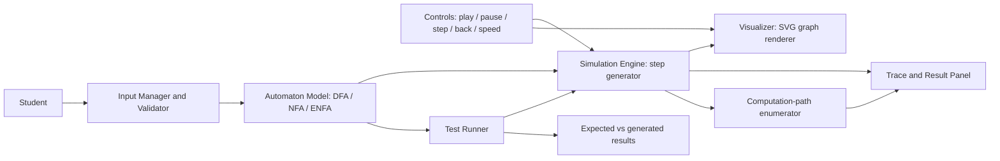
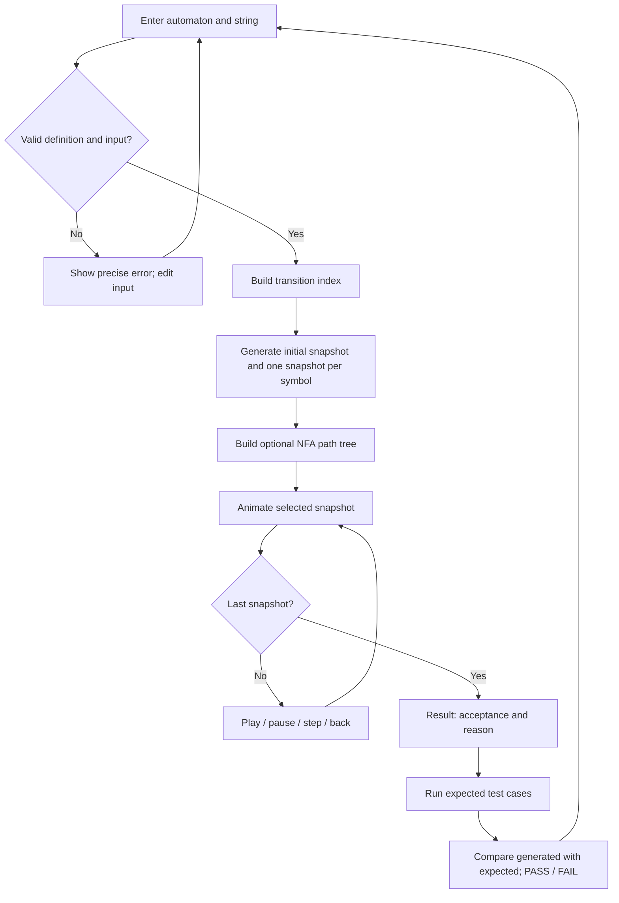
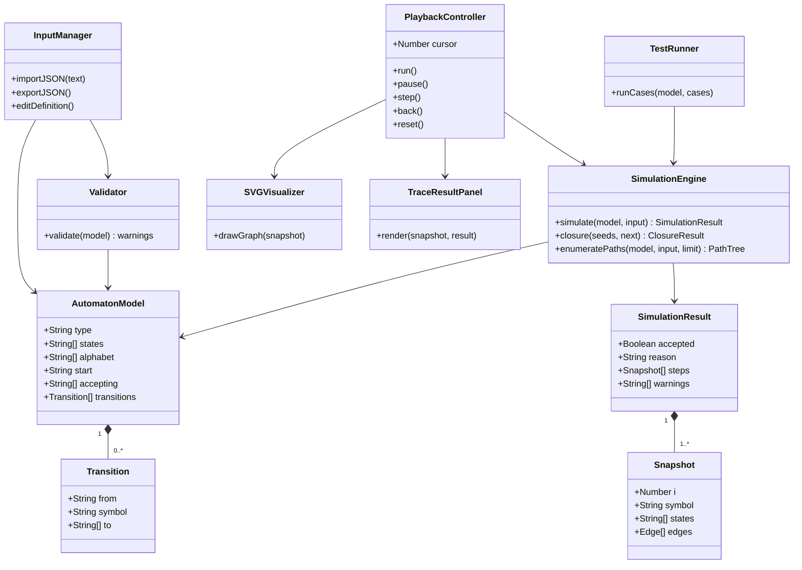

# 3. Simulator design and methodology

> Design documentation carried forward from M1. The final implementation adds controlled-language/regex construction, up to 128 states, zoom and actual browser verification. See the final README, CODE_GUIDE, technical report and VALIDATION_REPORT for current scope and measured results.
**Rubric:** Simulator Design & Methodology (2/5)

## Architecture



`engine.js` has no DOM access. It validates a definition, builds indexed transitions, and returns a complete array of snapshots. The UI animates this array; moving backward selects an earlier snapshot rather than reversing the transition relation. The architecture's step generator is implemented as an eager snapshot builder, appropriate for the 300-symbol input limit.

| Module | Responsibility | Implementation |
|---|---|---|
| Input Manager and Validator | UI values, JSON parsing, structure/semantic errors, unreachable-state warning | `app.js` editor + `engine.js: validate` |
| Automaton Model | Plain object with type, states, alphabet, start, finals, transitions | Shared JSON shape and `presets.js` |
| Simulation Engine | Initial closure, symbol moves, closure, active sets, final verdict | `engine.js: simulate`, `closure` |
| Path Enumerator | Keep alternative branches separate; mark cycles, dead ends, acceptance; cap display | `engine.js: enumeratePaths` |
| Visualizer | Circular state layout; grouped labels; loops; reciprocal curves; active states/edges | `app.js: drawGraph` |
| Controls | Snapshot cursor, timer, pause/resume, reset, delay | `app.js` event handlers |
| Trace and Result Panel | Consumed/remaining symbols, trace prefix, path rows, reason banner | `app.js: render` |
| Test Runner | Compare current-machine result with each user expectation | Browser validation lab; Node tests |

## Overall flowchart



The full string is checked for invalid symbols before processing. Such input gives INPUT ERROR, not a misleading partial trace. Even when the NFA active set becomes empty, the remaining positions have empty-set snapshots, so the consumed-input trace is explicit.

## UML class diagram (logical design)

The diagram shows conceptual classes and data structures. The prototype implements these roles with plain objects and functions, not JavaScript classes or a class hierarchy.



## Sequence: user runs a string

```mermaid
sequenceDiagram
  actor User
  participant UI as Input Manager
  participant Engine as Pure Engine
  participant Control as Playback Controller
  participant Graph as SVG Visualizer
  participant Panel as Trace / Result
  User->>UI: Define machine and enter w; click Run
  UI->>Engine: simulate(model, w)
  Engine->>Engine: Validate; index transitions; compute snapshots
  alt Invalid definition or symbol
    Engine-->>UI: Throw explanatory error
    UI-->>User: Show INPUT ERROR / editor message
  else Valid input
    Engine-->>Control: Steps, accepted, reason
    opt NFA or ENFA
      Control->>Engine: enumeratePaths(model, w, 1500)
      Engine-->>Control: Tree nodes and truncation flag
    end
    loop Each selected snapshot
      Control->>Graph: Draw active states and used edges
      Control->>Panel: Show trace prefix and consumed input
      User->>Control: Pause / Step / Back / adjust delay
    end
    Control->>Panel: At last step, reveal verdict and reason
    Panel-->>User: ACCEPTED or REJECTED
  end
```

Run starts from position 0, or resumes an unfinished paused run. Run after a completed run restarts it. Step when no simulation exists initializes position 0; subsequent clicks consume one symbol each. Back pauses and decrements the cursor. Reset pauses and returns to position 0 while preserving the model and string. For a blank string, position 0 is also the final position and the verdict is immediate. Delay is the time between snapshots; larger means slower.

## UI wireframe

```text
+-----------------------------------------------------------------------+
| CSET302 / M1          STATE STUDIO                 DFA / NFA / ε-NFA    |
+--------------------------+--------------------------------------------+
| AUTOMATON EDITOR         | SIMULATION CANVAS                 Step 4/4 |
| Preset [DFA ends in 01 v] | Input string [0101_____________] [Run]     |
| Model  [DFA           v] |                                            |
| Alphabet [0,1] [Apply]   |      start --> (q0) --> (q1) --> ((q2))    |
| New state [q3____] [Add] |            labelled SVG graph             |
| State | Start | Final   |                                            |
| q0    |   o   | [ ] [x] | [Back] [Step] [Pause] [Reset]  Delay [---] |
| q1    |       | [ ] [x] | Consumed: 0101        Remaining: blank     |
| q2    |       | [x] [x] | ACCEPTED: active final state q2            |
|                         +--------------------------------------------+
| From | Read | To        | STEP TRACE                                 |
| q0   | 0    | q1        | Step | Read | Active states | Transitions  |
| ...                     | 0    | —    | {q0}          | —            |
| [Apply & validate]      | ...                                        |
| > JSON import / export  +--------------------------------------------+
|                         | NFA PATH TREE: node / parent / status      |
|                         | Branches; dead ends; green accepting paths |
|                         +--------------------------------------------+
|                         | VALIDATION LAB                  [Run all] |
|                         | Editable [string, expected] cases          |
|                         | String | Expected | Generated | PASS/FAIL  |
+--------------------------+--------------------------------------------+
```

The static, script-free design is [`mockup.html`](mockup.html). The interactive prototype uses the same visual layout. NFA path rows form an adjacency-list tree: node IDs and parent IDs explicitly show branching, while indentation makes it readable. Green marks accepting paths; text labels identify dead ends, so color is not the only signal. The SVG graph shows all states, start arrow, final double circles, self-loops, grouped labels, and the selected snapshot's active states/edges.

## Input → processing → output workflow

1. Input Manager converts form/table entries or imported JSON into the common model. A complete JSON import is validated before replacement.
2. Validator checks structural and semantic rules. Reachability analysis warns about unused states. Invalid drafts cannot run.
3. Engine builds an adjacency index. Snapshot 0 contains q₀ or its ε-closure.
4. For each input symbol, engine unions destinations; ENFA then takes ε-closure. Each snapshot stores position, symbol, states, and exact edges used.
5. Final state intersection with F determines acceptance. The reason string explains the result; the UI reveals it only at the final snapshot.
6. The optional path enumerator preserves individual branches and marks dead or accepting endpoints. Repeated configurations on one branch summarize ε cycles.
7. Controller schedules or selects snapshots. SVG and trace are pure presentations of the selected snapshot. Edits invalidate old results.
8. Test Runner repeats simulation for user cases and compares expected vs generated. ERROR is a separate expectation for invalid strings. A model-level error stops the batch rather than pretending every case was a language rejection.

## Technology choice

Vanilla HTML/CSS/JavaScript and SVG keep the code understandable for a B.Tech CSE viva. Classic script tags allow `file://` launch without module-fetch restrictions. No build or network is needed. Node's built-in `assert` tests the same engine without a browser. JSON is portable and avoids inventing a custom machine syntax. Mermaid is used only for readable design documentation on GitHub.

The prototype deliberately trades sophisticated graph layout for a small circular renderer. Dense graphs may have overlapping labels; a production version could add dragging or an advanced layout algorithm after M1.
